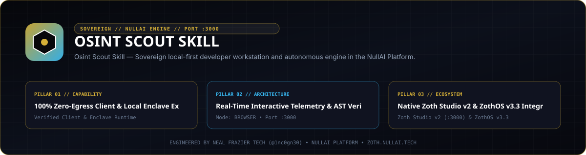
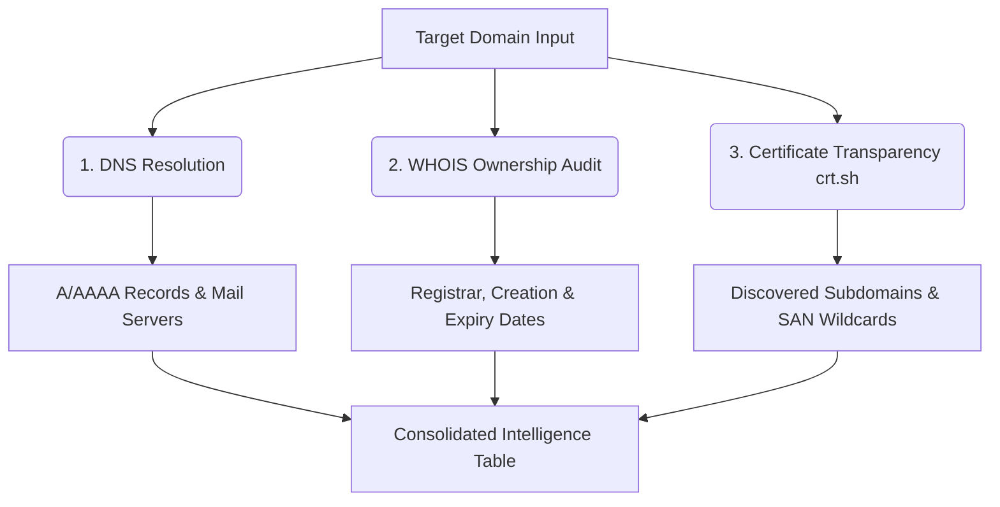

<div align="center">
  
</div>

<br />

# 🔍 Domain Intel Scout Skill & Web Recon Studio

> **Autonomous Passive Reconnaissance & Attack Surface Discovery Engine for Sovereign AI Agents & Web Operators**  
> *Structured first-pass domain intelligence using DNS enumeration, WHOIS ownership inspection, and Certificate Transparency logs via crt.sh.*

[](https://osint-domain-scout.netlify.app/)
[](https://osint-domain-scout.netlify.app/)
[](https://buy.stripe.com/3cIfZg27PdKo2D64Ocfw40X)
[](solana:GG2eQbVh8ut1BK6j1A2tz7pSySdLpD38BgyEhGcxdXoK)
[](#overview)
[](#compatibility)
[](#safety--ethics)
[](#license)

Live interactive workstation deployed at [https://osint-domain-scout.netlify.app/](https://osint-domain-scout.netlify.app/). Operates 100% in-browser with zero cloud telemetry, querying DNS-over-HTTPS (DoH) and Certificate Transparency records directly.

---

## ✦ Overview

**Domain Intel Scout** is an autonomous skill module designed for agentic workflows (compatible with Nous Research Hermes Agent, Codex CLI, and Google AGY SDK). It equips agents with an automated, non-invasive reconnaissance workflow to map an organization's digital footprint without human micro-management.

Unlike noisy active vulnerability scanners, Domain Intel Scout operates entirely passively, extracting intelligence from public authoritative nameservers, registrar records, and cryptographic Certificate Transparency (CT) logs.

---

## ✦ Capabilities & Procedures



### 1. DNS Reconnaissance
Identifies primary IPv4/IPv6 endpoints, mail servers (MX), and cloud hosting providers:
```bash
dig +short A <domain>
dig +short AAAA <domain>
dig +short MX <domain>
dig +short TXT <domain>
```

### 2. Registrar & Ownership Audit
Filters privacy redaction noise to isolate critical dates and authoritative registrars:
```bash
whois <domain> | grep -Ei "Creation Date|Registrar|Registry Expiry"
```

### 3. Passive Subdomain Discovery via CT Logs
Queries the global public Certificate Transparency logs without sending a single packet to the target server:
```bash
curl -s "https://crt.sh/?q=%25.<domain>&output=json" | jq -r '.[].common_name' | sort -u
```

---

## ✦ Installation & Compatibility

### For Nous Hermes Agent
Drop into your Hermes skills directory:
```bash
hermes skill install NullAITech/osint-scout-skill
```

### For ZothOS / Local Agent Swarms
Symlink or copy into `~/.hermes/skills/` or `~/.agents/skills/`:
```bash
git clone https://github.com/NullAITech/osint-scout-skill.git ~/.hermes/skills/domain-intel-scout
```

### Required Dependencies
* `dnsutils` (`dig`)
* `whois`
* `curl`
* `jq`

---

### 4. ZothOS CLI & Python Server Commands

```bash
# Check daemon status & health
osint-scout --status

# Passive DNS and attack surface scan on target domain
osint-scout scan nullai.tech

# Output deterministic JSON telemetry
osint-scout --json

# Run local daemon on port 8085
osint-scout serve --port 8085
```

---

## ☕ 100% Free Open-Access Architecture & Support

Domain Intel OSINT Scout is **100% free, unlocked, and open-access by default**. There are zero paywalls, zero license keys, zero blurred cards, and zero hidden costs.

If you appreciate sovereign local-first security tooling and zero-egress passive reconnaissance, support continued development:

- ☕ **Buy Us a Coffee (Stripe)**: [https://buy.stripe.com/3cIfZg27PdKo2D64Ocfw40X](https://buy.stripe.com/3cIfZg27PdKo2D64Ocfw40X)
- ◎ **Solana Tip Address**: `GG2eQbVh8ut1BK6j1A2tz7pSySdLpD38BgyEhGcxdXoK`

---

## ✦ Safety, Ethics & Rules of Engagement

- **Authorized Auditing**: Intended strictly for security researchers, developers, and red teams auditing infrastructure with appropriate authorization.
- **Zero Port Scanning**: This skill performs **zero** TCP/UDP port scans and sends no intrusive payloads.
- **Zero Exfiltration**: All parsed metadata is presented directly in the operator's terminal context in clean markdown tables.

---

## ✦ License

Part of the **[NullAI Tech](https://github.com/NullAITech)** open security ecosystem. Distributed under the MIT License.

---

Engineered by **1nc0gn30 • NullAI** ([@1nc0gn30](https://github.com/1nc0gn30)) • [NullAI Platform](https://nullai.tech)  
*Sovereign Local-First Architecture • 100% In-Browser Threat Recon • Zero Cloud Egress*
