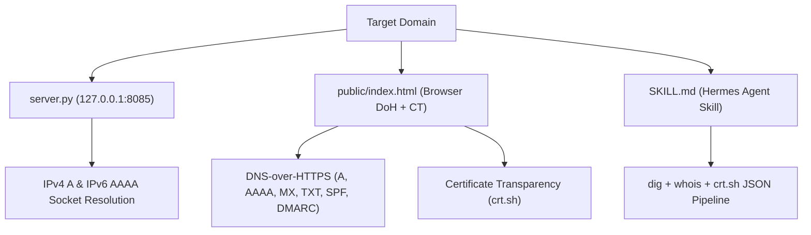

<div align="center">
  
</div>

# Domain Intel OSINT Scout

[](https://zoth.nullai.tech/tools/osint-scout-skill)
[](http://127.0.0.1:8085)
[](SKILL.md)
[](LICENSE)

Passive domain intelligence workstation, local loopback REST daemon, and autonomous agent skill (`SKILL.md`). Performs non-intrusive reconnaissance across DNS/DNS-over-HTTPS (DoH) records, WHOIS registrar metadata, SPF/DMARC email posture, and Certificate Transparency (`crt.sh`) subdomain logs without sending active port-scanning packets.

## Overview

**Domain Intel OSINT Scout** (`osint-scout-skill`) ships as both a structured agent skill module (compatible with Nous Research Hermes Agent and Codex-style skill runners) and an interactive browser/loopback workstation integrated into **Zoth Studio v2** (`https://zoth.nullai.tech/tools/osint-scout-skill`) and **ZothOS v3.4.0**.

| Property | Value |
| :--- | :--- |
| **Tool ID** | `osint-scout-skill` |
| **Skill Identifier** | `domain-intel-scout` (`SKILL.md`) |
| **Category** | `Security & Recon` |
| **Loopback Bind** | `127.0.0.1:8085` |
| **Zoth Studio v2 Dossier** | `https://zoth.nullai.tech/tools/osint-scout-skill` |
| **Local Studio Route** | `http://127.0.0.1:3000/tools/osint-scout-skill` |
| **Runtime Dependencies** | Python 3.10+ stdlib (`server.py`); `whois`, `dnsutils` (`dig`), `curl`, `jq` for `SKILL.md` shell procedures |
| **License** | MIT (100% free and open-source) |

## Architecture



- **`server.py`**: Zero-dependency Python `HTTPServer` bound to `127.0.0.1:8085`, serving the `public/` workstation and passive DNS resolution endpoints (`/health`, `/api/health`, `/api/recon?domain=<domain>`).
- **`public/index.html`**: Client-side OSINT workstation querying DNS-over-HTTPS (`A`, `AAAA`, `MX`, `TXT`, `NS`), evaluating SPF/DMARC configuration posture, and enumerating subdomains from public Certificate Transparency logs.
- **`SKILL.md`**: Agent skill manifest (`domain-intel-scout`) defining deterministic first-pass DNS (`dig +short`), registrar (`whois`), and passive subdomain (`crt.sh`) procedures with strict non-intrusive rules of engagement.
- **`bin/osint-scout-skill` & `bin/osint-scout-skill-tui`**: Portable CLI wrapper and Unicode `U+2800` Braille telemetry harness.

## Quickstart

```bash
git clone https://github.com/NullAITech/osint-scout-skill.git
cd osint-scout-skill

# Start the loopback server on 127.0.0.1:8085
python3 server.py --host 127.0.0.1 --port 8085
```

Open `http://127.0.0.1:8085` in a browser, or query the REST endpoints directly:

```bash
# Daemon health check
curl -s http://127.0.0.1:8085/health | python3 -m json.tool

# Passive IPv4/IPv6 record resolution
curl -s "http://127.0.0.1:8085/api/recon?domain=nullai.tech" | python3 -m json.tool
```

### REST API Endpoints

| Method | Route | Description |
| :--- | :--- | :--- |
| `GET` | `/health`, `/api/health` | Returns service health, tool metadata, port (`8085`), and daemon uptime in seconds. |
| `GET` | `/api/recon?domain=<domain>` | Resolves `A` (IPv4) and `AAAA` (IPv6) records passively via `socket.getaddrinfo` and returns timestamped JSON. Returns `400` if `domain` is omitted. |
| `GET` | `/` | Serves the static browser workstation from `public/`. |

## CLI & Agent Skill Usage

### ZothOS v3.4.0 & Local CLI

```bash
# Show CLI help and subcommands
./bin/osint-scout-skill --help

# Output JSON installation and daemon telemetry
./bin/osint-scout-skill --json

# Run passive domain reconnaissance (queries :8085 daemon or falls back to local socket)
./bin/osint-scout-skill scan nullai.tech

# Start the HTTP daemon on 127.0.0.1:8085
./bin/osint-scout-skill serve --host 127.0.0.1 --port 8085

# Render the Unicode U+2800 Braille TUI sparkline view or JSON benchmark
./bin/osint-scout-skill-tui
./bin/osint-scout-skill-tui --json
```

### Hermes Agent & Skill Installation

Install `SKILL.md` into Nous Research Hermes Agent or a local skills directory:

```bash
# Install via Hermes CLI
hermes skill install NullAITech/osint-scout-skill

# Or clone directly into a local skills folder
git clone https://github.com/NullAITech/osint-scout-skill.git ~/.hermes/skills/domain-intel-scout
```

Skill procedures defined in `SKILL.md` (for authorized infrastructure only; zero active TCP/UDP port scanning):

```bash
dig +short A <domain>
dig +short MX <domain>
whois <domain> | grep -Ei "Creation Date|Registrar|Registry Expiry"
curl -s "https://crt.sh/?q=%25.<domain>&output=json" | jq -r '.[].common_name' | sort -u
```

## Testing & Verification

```bash
# Run Python unit and HTTP/CLI integration tests
python3 -m pytest -q

# Or via npm script
npm test
```

## License

Released under the [MIT License](LICENSE). Copyright (c) 2026 [1nc0gn30](https://1nc0gn30.si) (`@1nc0gn30`) & [NullAI](https://nullai.tech).

100% free and open-source with zero paywalls. Optional support: [Buy Us a Coffee (Stripe)](https://buy.stripe.com/3cIfZg27PdKo2D64Ocfw40X).
